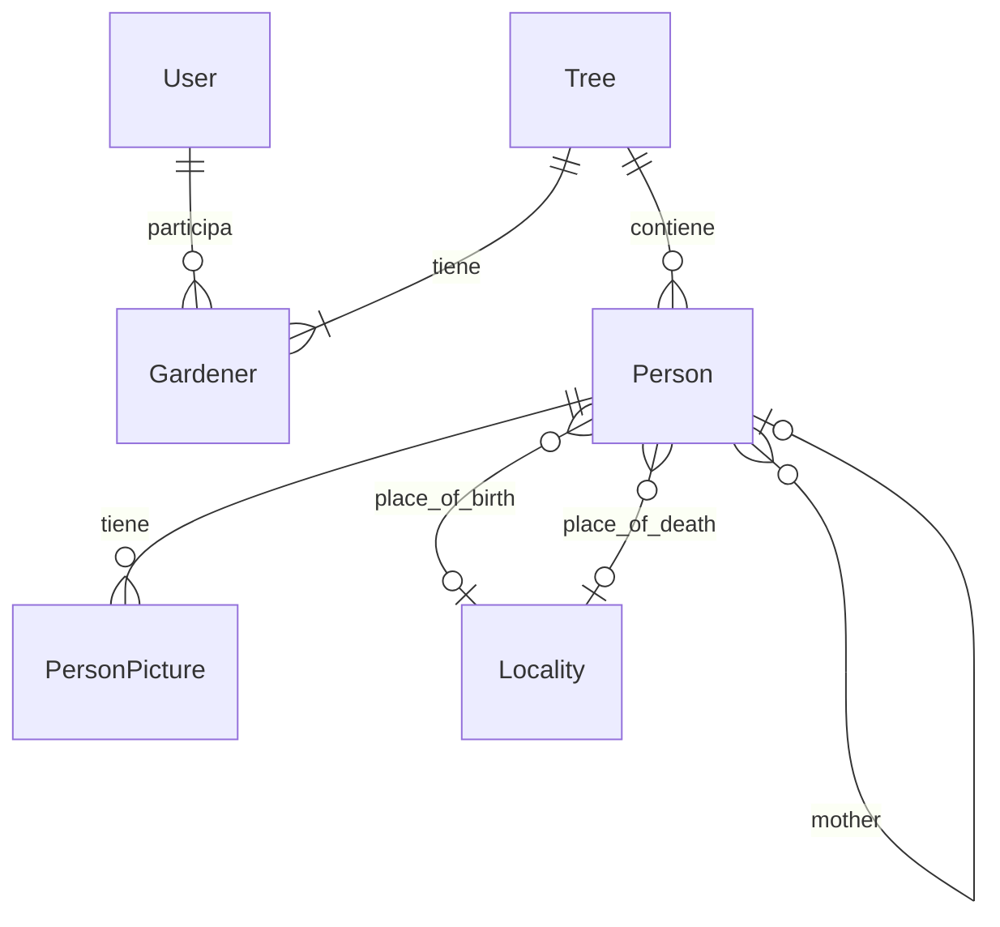

# Modelo entidad–relación

Proyecto: archivo histórico y genealógico de San Andrés de la Cal, Tepoztlán, Morelos, México.

Actualizado: 2026-11-24.

## 1. Alcance del diseño

Este documento describe el diseño vigente para admitir varios árboles y colaboradores. Al actualizarlo se sustituyen las decisiones que cambien, sin conservar un historial ni comparaciones con diseños anteriores.

`Gardener` es el nombre acordado para la participación de un usuario en un árbol. `Tree.visibility` determina si el árbol es `public` o `private`. `Person.place_of_birth` y `Person.place_of_death` identifican las localidades de nacimiento y fallecimiento. `Person.portrait` y `Person.tree_portrait` contienen los retratos para resultados de búsqueda y nodos del árbol. `PersonPicture` contiene las imágenes de la galería. Los demás nombres en inglés siguen sujetos a revisión.

Los detalles técnicos propuestos y las decisiones pendientes se indican expresamente. [models.py](models.py) sirve como referencia de implementación; este documento define el diseño y no implica que todos sus campos estén implementados.

| Modelo | Propósito | Definición |
| --- | --- | --- |
| `User` — Usuario | Cuenta de quien accede al sitio y participa en árboles. | Esquema de autenticación propuesto. |
| `Tree` — Árbol | Colección de personas, relaciones e historias, con visibilidad pública o privada. | Entidad y visibilidad acordadas; detalles técnicos propuestos. |
| `Gardener` | Participación de un usuario en un árbol y su rol. | Nombre, relación y roles acordados; detalles técnicos propuestos. |
| `Person` — Persona | Individuo documentado dentro de un árbol. | Pertenece a un solo árbol; tiene vínculos familiares con personas de ese árbol. |
| `PersonPicture` | Imagen de la galería de una persona. | Nombre, campos y orden de presentación acordados; detalles técnicos propuestos. |
| `Locality` — Localidad | Localidad geográfica y contenido sobre ella. | Alcance de su contenido editorial pendiente de definir. |

Una cuenta `User` y una ficha `Person` representan conceptos diferentes. Registrar a un antepasado no requiere crearle una cuenta, y no se presupone una vinculación automática entre ambos modelos.

## 2. Convenciones de campos

- **PK:** clave primaria del registro.
- **FK:** clave foránea hacia otro registro. Un atributo Django como `father` se almacena normalmente en una columna `father_id`.
- **M2M:** relación de muchos a muchos, implementada mediante una tabla intermedia.
- **Obligatorio:** requerido por la validación del modelo o formulario. No equivale a una restricción SQL que rechace cadenas vacías.
- **Opcional:** puede omitirse. Los textos opcionales usan `blank=True` y admiten una cadena vacía; las fechas y FK opcionales también usan `null=True`.
- **Automático:** el sistema asigna el valor; el editor no tiene que capturarlo.

Las tablas indican el tipo Django y su representación prevista en PostgreSQL. `ImageField` guarda una referencia al archivo; con el almacenamiento previsto, el objeto estará en R2. No guarda los bytes de la fotografía en la fila.

Se propone usar UUID como PK. Los tamaños de texto propuestos no son decisiones definitivas.

## 3. Diagrama del núcleo

Todas las relaciones entre `Tree` y `User` se representan mediante `Gardener`. La propiedad del árbol corresponde al rol `owner`.

| Relación | Cardinalidad y significado |
| --- | --- |
| `User` ↔ `Tree` | Muchos a muchos mediante `Gardener`. Un usuario puede participar en varios árboles con roles diferentes. |
| `Tree` → `Gardener` | Un árbol válido tiene al menos un participante con rol `owner`; puede tener más participantes. Esa condición requiere validación adicional a las FK. |
| `Tree` → `Person` | Un árbol contiene cero o muchas personas. Cada persona pertenece a un solo árbol. |
| `Person` → `PersonPicture` | Una persona tiene cero o muchas imágenes de galería. Cada imagen pertenece a una sola persona. |
| `Person` → `Person`, por `father` | Una persona tiene cero o un padre registrado; ese padre puede tener muchos hijos. |
| `Person` → `Person`, por `mother` | Una persona tiene cero o una madre registrada; esa madre puede tener muchos hijos. |
| `Person` → `Locality`, por `place_of_birth` | Una persona tiene cero o una localidad de nacimiento registrada; una localidad puede ser lugar de nacimiento de muchas personas. |
| `Person` → `Locality`, por `place_of_death` | Una persona tiene cero o una localidad de fallecimiento registrada; una localidad puede ser lugar de fallecimiento de muchas personas. |

La entidad de relaciones de pareja está pendiente de diseñar.

## 4. User — Usuario

**Propuesta técnica:** usuario propio de Django derivado de `AbstractUser`, con UUID. La elección concreta de autenticación queda pendiente.

Los campos de referencia serían:

| Campo | Tipo Django / PostgreSQL | Captura o valor inicial | Descripción |
| --- | --- | --- | --- |
| `id` | `UUIDField` / `uuid`, PK | Automático: `uuid.uuid4`. | Identificador de la cuenta. |
| `username` | `CharField(150)` / `varchar(150)` | Obligatorio, único. | Nombre de acceso. |
| `first_name` | `CharField(150)` / `varchar(150)` | Opcional. | Nombre o nombres. |
| `last_name` | `CharField(150)` / `varchar(150)` | Opcional. | Apellidos. |
| `email` | `EmailField(254)` / `varchar(254)` | Opcional en esta propuesta. | Correo electrónico. |
| `password` | `CharField(128)` / `varchar(128)` | Gestionado por Django. | Hash de contraseña y sus metadatos. |
| `is_active` | `BooleanField` / `boolean` | `True`. | Cuenta habilitada. |
| `is_staff` | `BooleanField` / `boolean` | `False`. | Acceso al administrador de Django, sujeto a permisos. |
| `is_superuser` | `BooleanField` / `boolean` | `False`. | Privilegios globales de Django. |
| `last_login` | `DateTimeField` / `timestamptz` | Automático, admite `NULL`. | Último inicio de sesión. |
| `date_joined` | `DateTimeField` / `timestamptz` | Fecha de alta. | Creación de la cuenta. |
| `groups` | M2M hacia `Group` | Opcional. | Grupos globales de Django. |
| `user_permissions` | M2M hacia `Permission` | Opcional. | Permisos globales individuales de Django. |

`groups` y `user_permissions` usan tablas intermedias, no columnas de lista. Referencia: [usuario de Django](https://docs.djangoproject.com/en/5.2/ref/contrib/auth/#user-model).

Ser `owner` de un árbol no convierte a nadie en `is_staff` o `is_superuser`. Los roles de árbol se consultan en `Gardener` y se aplican a cada operación sobre ese árbol.

Pendientes: confirmar esta base, si se accede por nombre de usuario o correo, y si el correo será obligatorio y único. La propuesta usa `AUTH_USER_MODEL`; no implica crear una segunda cuenta paralela a la autenticación de Django. [Personalización del usuario](https://docs.djangoproject.com/en/5.2/topics/auth/customizing/#using-a-custom-user-model-when-starting-a-project).

## 5. Tree — Árbol

La entidad y el campo `visibility`, con valores `public` y `private`, están acordados. Los tipos, tamaños y campos auxiliares son una propuesta técnica.

Un árbol puede representar una familia, varias familias o una comunidad completa. No necesita tener una única persona raíz permanente.

| Campo | Tipo Django / PostgreSQL | Captura o valor inicial | Descripción |
| --- | --- | --- | --- |
| `id` | `UUIDField` / `uuid`, PK | Automático: `uuid.uuid4`. | Identificador estable del árbol. |
| `name` | `CharField(200)` / `varchar(200)` | Obligatorio. | Nombre elegido por el creador, por ejemplo «El Árbol de San Andrés». |
| `description` | `TextField` / `text` | Opcional. | Propósito, alcance y presentación del árbol. |
| `visibility` | `CharField(7)` / `varchar(7)` | Obligatorio; valor predeterminado pendiente de definir. | Acceso a la consulta: `public` para cualquiera y `private` para usuarios con un registro `Gardener` en este árbol. |
| `slug` | `SlugField(200)` / `varchar(200)` | Obligatorio, único en el sitio. | Segmento legible de su dirección web. |
| `created_at` | `DateTimeField` / `timestamptz` | Automático: `auto_now_add=True`. | Momento de creación. |
| `updated_at` | `DateTimeField` / `timestamptz` | Automático: `auto_now=True`. | Última modificación de esta fila. |

### Reglas

- El propietario se representa mediante `Gardener.role = owner`.
- Crear un árbol incluye crear la membresía `owner` de su creador en la misma operación atómica.
- Dos árboles pueden tener el mismo nombre. Si se adopta el `slug` propuesto, sus slugs sí deben diferenciarse.
- `visibility = public`: cualquiera puede consultar el árbol, incluso sin iniciar sesión y sin un registro `Gardener`.
- `visibility = private`: solo pueden consultarlo los usuarios con un registro `Gardener` en ese árbol, con rol `owner`, `editor` o `reader`.
- Ser `owner` o `editor` incluye permiso de consulta; no requiere una participación adicional como `reader`.
- La visibilidad pública permite consultar; la edición y administración requieren el rol correspondiente.
- Cambiar `visibility` corresponde al `owner` y conserva los registros `Gardener` existentes.
- Los únicos valores admitidos para `visibility` son `public` y `private`. Su valor predeterminado queda pendiente de decidir.
- `updated_at` de este modelo no se actualiza automáticamente cuando cambia una persona, fotografía o membresía del árbol.

## 6. Gardener

Representa la participación de un usuario en un árbol. Incluye los roles `owner`, `editor` y `reader`; el nombre no implica que todos los participantes puedan editar.

El nombre, las referencias y los roles están acordados. PK, tamaños, timestamps y comportamiento de borrado son propuestas técnicas.

| Campo | Tipo Django / PostgreSQL | Captura o valor inicial | Descripción |
| --- | --- | --- | --- |
| `id` | `UUIDField` / `uuid`, PK | Automático: `uuid.uuid4`. | Identificador de la participación. |
| `user` | FK a `User` / `uuid` | Obligatorio. | Cuenta que participa en el árbol. Propuesta: `CASCADE` al eliminar la cuenta, sujeto a conservar propietario. |
| `tree` | FK a `Tree` / `uuid` | Obligatorio. | Árbol al que corresponde la participación. Propuesta: `CASCADE` al eliminar el árbol. |
| `role` | `CharField(10)` / `varchar(10)` | Obligatorio; sin valor predeterminado propuesto. | Rol: `owner`, `editor` o `reader`. |
| `created_at` | `DateTimeField` / `timestamptz` | Automático: `auto_now_add=True`. | Inicio de la participación. |
| `updated_at` | `DateTimeField` / `timestamptz` | Automático: `auto_now=True`. | Última modificación, por ejemplo del rol. |

### Roles y permisos

| Acción | `owner` | `editor` | `reader` |
| --- | --- | --- | --- |
| Consultar personas e historias | Sí | Sí | Sí |
| Crear, modificar y borrar personas, relaciones e historias | Sí | Sí | No |
| Cambiar nombre, descripción y visibilidad del árbol | Sí | No | No |
| Administrar colaboradores y sus roles | Sí | No | No |
| Eliminar el árbol completo | Sí | No | No |

### Reglas

- Un solo registro `Gardener` por combinación `(user, tree)`: restricción única compuesta.
- El mismo usuario puede ser `owner` en un árbol y `editor` en otro.
- Un árbol debe conservar al menos un `owner`. No se puede borrar su última membresía propietaria ni cambiarle el rol sin asignar un sustituto.
- La eliminación de una cuenta debe resolver primero la propiedad de sus árboles; una cascada de membresías no garantiza esa regla.
- Permitir uno o varios propietarios simultáneos queda pendiente de confirmar.
- Se propone una restricción de valores válidos para `role`, además de las opciones del formulario.
- `reader` permite consultar un árbol privado sin editarlo. Consultar un árbol público no requiere un registro `Gardener`.
- Guardar el rol no aplica los permisos por sí mismo: las vistas y operaciones de edición deben comprobar la membresía del árbol correspondiente.

## 7. Person — Persona

Representa una ficha individual dentro de un árbol. Los campos definidos son los siguientes; las decisiones abiertas se indican al final de la sección.

### 7.1. Identidad, fechas y lugares

| Campo | Tipo Django / PostgreSQL | Captura o valor inicial | Descripción |
| --- | --- | --- | --- |
| `id` | `UUIDField` / `uuid`, PK | Automático: `uuid.uuid4`; no editable. | Identificador estable de esta ficha. |
| `full_name` | `CharField(200)` / `varchar(200)` | Obligatorio. | Nombre completo, sin exigir separación por nombres y apellidos. No es único. |
| `alias` | `CharField(50)` / `varchar(50)` | Opcional. | Apodo o nombre alternativo. |
| `date_of_birth` | `DateField` / `date` | Opcional; admite `NULL`. | Fecha completa de nacimiento cuando se conoce. |
| `place_of_birth` | FK a `Locality` / `uuid` | Opcional; admite `NULL`. | Localidad donde nació. `SET_NULL` al eliminar la localidad mediante Django: la ficha de la persona se conserva. |
| `date_of_death` | `DateField` / `date` | Opcional; admite `NULL`. | Fecha completa de defunción cuando se conoce. |
| `place_of_death` | FK a `Locality` / `uuid` | Opcional; admite `NULL`. | Localidad donde falleció. `SET_NULL` al eliminar la localidad mediante Django: la ficha de la persona se conserva. |
| `sex` | `CharField(1)` / `varchar(1)` | Opcional; opciones de `choices.Sex.choices`. | Sexo registrado. Los valores concretos no se pueden enumerar porque `choices.py` no está en este workspace. |

Los lugares de nacimiento y fallecimiento son independientes y pueden referirse a la misma localidad o a localidades diferentes. Se pueden registrar aunque se desconozca la fecha correspondiente; conocer una fecha tampoco obliga a conocer el lugar.

### 7.2. Contenido histórico

| Campo | Tipo Django / PostgreSQL | Captura | Descripción |
| --- | --- | --- | --- |
| `biography` | `TextField` / `text` | Opcional. | Biografía de la persona. |
| `autobiography` | `TextField` / `text` | Opcional. | Relato autobiográfico de la persona. |
| `interesting_facts` | `TextField` / `text` | Opcional. | Datos o hechos de interés. |
| `anecdotes` | `TextField` / `text` | Opcional. | Anécdotas relacionadas con la persona. |
| `see_more_at` | `TextField` / `text` | Opcional. | Referencias, enlaces o lugares donde investigar más. Actualmente es texto libre, no una entidad de fuentes. |

### 7.3. Retratos

Ambos campos son opcionales y contienen referencias a imágenes procesadas, almacenadas en R2. Sin un `max_length` explícito, `ImageField` utiliza una referencia de hasta 100 caracteres.

| Campo | Tipo Django / PostgreSQL | Captura | Descripción |
| --- | --- | --- | --- |
| `portrait` | `ImageField` / `varchar(100)` | Opcional. | Retrato optimizado para representar a la persona en los resultados de búsqueda. |
| `tree_portrait` | `ImageField` / `varchar(100)` | Opcional. | Retrato optimizado para mostrarse dentro del nodo del árbol genealógico. |

Los retratos pueden generarse a partir de la misma fotografía o de fotografías diferentes. Agregar imágenes a la galería conserva los retratos elegidos. Sus dimensiones y detalles de recorte quedan pendientes de definir.

### 7.4. Relaciones y administración

| Campo | Tipo Django / PostgreSQL | Captura o valor inicial | Descripción |
| --- | --- | --- | --- |
| `tree` | FK a `Tree` / `uuid` | Obligatorio. | Árbol al que pertenece esta ficha. Comportamiento de borrado pendiente de decidir; se propone borrar las fichas al eliminar explícitamente el árbol. |
| `father` | FK a `Person` / `uuid` | Opcional; admite `NULL`. | Padre de sangre registrado. `SET_NULL` al eliminarlo mediante Django: la ficha del hijo se conserva. |
| `mother` | FK a `Person` / `uuid` | Opcional; admite `NULL`. | Madre de sangre registrada. `SET_NULL` al eliminarla mediante Django: la ficha del hijo se conserva. |
| `is_archived` | `BooleanField` / `boolean` | `False`. | Marca que la información debe dejar de mostrarse públicamente. Las consultas y vistas deben aplicar ese comportamiento. |
| `slug` | `SlugField(50)` / `varchar(50)` | Obligatorio, único en todo el sitio. | Identificador legible para la dirección de la ficha. |
| `metadata` | `JSONField` / `jsonb` | Opcional en validación; valor inicial `{}` mediante `default=dict`. | Metadatos auxiliares. No sustituye las relaciones ni las columnas principales. |
| `created_at` | `DateTimeField` / `timestamptz` | Automático: `auto_now_add=True`. | Momento de creación de esta fila. |
| `updated_at` | `DateTimeField` / `timestamptz` | Automático: `auto_now=True`. | Última modificación de esta fila mediante el guardado ordinario del modelo. |

### 7.5. Reglas de pertenencia al árbol

- Una persona histórica puede aparecer en árboles diferentes mediante registros independientes, con UUID distintos.
- Dentro de un árbol, una misma ficha puede aparecer en varias ramas o vistas, por ejemplo por antepasados compartidos.
- No se impone unicidad por nombre ni se fusionan automáticamente personas entre árboles.
- `father` y `mother`, cuando existan, deben apuntar a personas del mismo árbol. Una FK simple solo comprueba que el destino exista; esta condición necesita validación adicional.
- La persona principal es el centro de la vista actual, no una propiedad fija de `Person` o `Tree`.

### 7.6. Definiciones pendientes

| Tema | Definición pendiente |
| --- | --- |
| Fechas incompletas | Estructura para años solos, fechas parciales y aproximaciones, con su precisión explícita. No se debe inventar una fecha exacta. |
| Estado vital | Representación de persona viva, fallecida y estado desconocido. La ausencia de fecha de defunción no demuestra que esté viva. |
| Slug | Confirmar el alcance de unicidad y si la dirección de la ficha utiliza slug o UUID. |
| Procesamiento de imágenes | Dimensiones, formatos y ajustes de recorte para los retratos y las imágenes de galería. |
| Autoría | Referencias a los usuarios que crean y modifican contenido y necesidad de conservar revisiones. |
| Historias y fuentes | Estructura de relatos independientes con autores, documentos y fuentes opcionales. |
| Acceso inverso a hijos | Nombres de los accesores de Django para recorrer la descendencia. |

Los nombres y tipos de las columnas para fechas incompletas y estado vital quedan pendientes.

## 8. PersonPicture

Representa una imagen de la galería de una persona. Cada persona puede adjuntar tantas imágenes como necesite; el conjunto de sus registros forma su galería.

El nombre y los campos están acordados. Se propone usar UUID como PK, conforme a la convención general.

| Campo | Tipo Django / PostgreSQL | Captura o valor inicial | Descripción |
| --- | --- | --- | --- |
| `id` | `UUIDField` / `uuid`, PK | Automático: `uuid.uuid4`; no editable. | Identificador estable de la imagen. |
| `person` | FK a `Person` / `uuid` | Obligatorio. | Persona a cuya galería pertenece; columna `person_id`. Se propone `CASCADE` al eliminar la persona mediante Django. |
| `picture` | `ImageField` / `varchar(100)` | Obligatorio. | Referencia a la imagen optimizada para la web, almacenada en R2. |
| `caption` | `TextField` / `text` | Opcional; admite varias líneas. | Descripción libre: contexto, personas que aparecen, fecha aproximada, procedencia y créditos. |
| `created_at` | `DateTimeField` / `timestamptz` | Automático: `auto_now_add=True`. | Momento en que se agregó el registro a la galería. |
| `updated_at` | `DateTimeField` / `timestamptz` | Automático: `auto_now=True`. | Última modificación de la imagen o su descripción mediante el guardado ordinario del modelo. |

### Reglas de galería

- Las imágenes se muestran por `created_at` descendente: primero las agregadas más recientemente.
- `created_at` representa la incorporación al sitio; la fecha en que se tomó la fotografía puede describirse en `caption`.
- Modificar una imagen o su descripción actualiza `updated_at` y conserva su orden de incorporación.
- La pertenencia al árbol y los permisos se obtienen mediante `person.tree`; la imagen respeta la visibilidad y los roles de ese árbol.
- La información descriptiva se escribe en `caption`. Las referencias estructuradas de autoría y fuentes quedan pendientes de un diseño específico.

### Procesamiento y almacenamiento de imágenes de personas

- R2 conserva los retratos y las imágenes de galería optimizados para la web. PostgreSQL guarda sus referencias.
- Las imágenes de galería conservan el encuadre completo con resolución suficiente para su consulta; las dimensiones y los formatos se definirán al implementar el procesamiento.
- Los archivos recibidos se utilizan temporalmente para generar las versiones necesarias y se descartan una vez procesadas y guardadas correctamente.
- El espacio para documentar el árbol y referenciar archivos externos se diseñará por separado.

## 9. Locality — Localidad

Representa una localidad geográfica. Los códigos de referencia corresponden al catálogo geográfico del INEGI.

### 9.1. Identidad geográfica

| Campo | Tipo Django / PostgreSQL | Captura o valor inicial | Descripción |
| --- | --- | --- | --- |
| `id` | `UUIDField` / `uuid`, PK | Automático: `uuid.uuid4`; no editable. | Identificador interno de la localidad. |
| `agee_code` | `CharField(2)` / `varchar(2)` | Obligatorio. | Código de la entidad federativa. Se conserva como texto. |
| `agee_name` | `CharField(30)` / `varchar(30)` | Obligatorio. | Nombre de la entidad federativa. |
| `agem_code` | `CharField(3)` / `varchar(3)` | Obligatorio. | Código del municipio; conserva ceros iniciales. |
| `agem_name` | `CharField(50)` / `varchar(50)` | Obligatorio. | Nombre del municipio. |
| `loc_code` | `CharField(4)` / `varchar(4)` | Obligatorio. | Código de la localidad; conserva ceros iniciales. |
| `loc_name` | `CharField(50)` / `varchar(50)` | Obligatorio. | Nombre de la localidad. |

La restricción `unique_locality` hace única la combinación `(agee_code, agem_code, loc_code)`. Los códigos de municipio y localidad no son únicos por separado en todo el catálogo.

### 9.2. Contenido histórico

| Campo | Tipo Django / PostgreSQL | Captura | Descripción |
| --- | --- | --- | --- |
| `history` | `TextField` / `text` | Opcional. | Historia de la localidad. |
| `interesting_facts` | `TextField` / `text` | Opcional. | Datos o hechos de interés sobre la localidad. |
| `see_more_at` | `TextField` / `text` | Opcional. | Referencias o lugares donde investigar más. |

### 9.3. Fotografías

Todas son opcionales. Las imágenes usan `upload_to="pictures/localities/"`.

| Campo | Tipo Django / PostgreSQL | Descripción |
| --- | --- | --- |
| `picture_1` | `ImageField` / `varchar(100)` | Primera fotografía de la galería. |
| `picture_1_caption` | `CharField(100)` / `varchar(100)` | Descripción de la primera fotografía. |
| `picture_2` | `ImageField` / `varchar(100)` | Segunda fotografía de la galería. |
| `picture_2_caption` | `CharField(100)` / `varchar(100)` | Descripción de la segunda fotografía. |
| `picture_3` | `ImageField` / `varchar(100)` | Tercera fotografía de la galería. |
| `picture_3_caption` | `CharField(100)` / `varchar(100)` | Descripción de la tercera fotografía. |
| `picture_4` | `ImageField` / `varchar(100)` | Cuarta fotografía de la galería. |
| `picture_4_caption` | `CharField(100)` / `varchar(100)` | Descripción de la cuarta fotografía. |
| `picture_5` | `ImageField` / `varchar(100)` | Quinta fotografía de la galería. |
| `picture_5_caption` | `CharField(100)` / `varchar(100)` | Descripción de la quinta fotografía. |

### 9.4. Administración

| Campo | Tipo Django / PostgreSQL | Captura o valor inicial | Descripción |
| --- | --- | --- | --- |
| `slug` | `SlugField(50)` / `varchar(50)` | Obligatorio, único. | Identificador legible de la localidad para su dirección web. |
| `metadata` | `JSONField` / `jsonb` | Opcional en validación; valor inicial `{}` mediante `default=dict`. | Metadatos auxiliares del registro. |
| `created_at` | `DateTimeField` / `timestamptz` | Automático: `auto_now_add=True`. | Momento de creación de esta fila. |
| `updated_at` | `DateTimeField` / `timestamptz` | Automático: `auto_now=True`. | Última modificación de esta fila mediante el guardado ordinario del modelo. |

### Alcance pendiente

Se propone compartir el catálogo geográfico entre árboles. Su historia, fotografías y demás contenido editorial necesitarían una pertenencia al árbol si queremos que cada autor conserve su propia versión. La ubicación de esos campos en entidades nuevas todavía no se ha decidido.

## 10. Reglas generales de relaciones e integridad

- Se guardan vínculos directos. Abuelos, bisabuelos, hermanos, medios hermanos, nietos y bisnietos se calculan a partir de ellos; no necesitan tablas propias por nivel.
- Tener hijos en común no demuestra que haya existido matrimonio. La filiación y la relación de pareja deben poder representarse por separado.
- La estructura debe admitir padres desconocidos y antepasados compartidos entre ramas.
- Se propone impedir que alguien se registre como su propio progenitor y detectar ciclos de ascendencia. Compartir un antepasado entre ramas no constituye un ciclo.
- Estos controles comprueban coherencia del modelo; no exigen que el autor demuestre documentalmente cada parentesco.
- Cada autor puede registrar su versión de los hechos. Las fuentes y los documentos serán opcionales, según lo acordado.
- Los roles se aplican dentro de cada árbol, también al crear, modificar o borrar sus personas y relaciones.
- La consulta de un árbol privado y sus fichas debe comprobar el acceso mediante `Gardener`; un árbol público permite consulta sin membresía.
- Eliminar un progenitor no debe eliminar automáticamente a sus hijos; se usa `SET_NULL`.
- Archivar una ficha y eliminarla son operaciones diferentes. El efecto de archivar sobre su presencia en el dibujo todavía debe definirse.
- Coordenadas, franjas, colores, orden visual y persona principal se calculan para la vista. No son datos genealógicos persistidos.

Los comportamientos `CASCADE` y `SET_NULL` descritos corresponden a `on_delete` de Django. Deben revisarse junto con las reglas de autorización y conservación antes de implementar borrados.

## 11. Decisiones pendientes para completar el diagrama

| Tema | Qué falta decidir |
| --- | --- |
| Nombres | Nombres definitivos de `User`, `Tree`, `Person`, `Locality` y los atributos pendientes. `Gardener`, `PersonPicture`, `visibility`, `place_of_birth`, `place_of_death`, `portrait` y `tree_portrait` están acordados. |
| Autenticación | Base de `User`, identificador de acceso y requisitos del correo. |
| Visibilidad | Valor predeterminado de `Tree.visibility` al crear un árbol. |
| Propiedad | Uno o varios `owner`; flujo para transferir propiedad y eliminar cuentas. |
| Parejas | Campos para registrar relaciones, matrimonios y uniones sin hijos; tratamiento de varias etapas entre las mismas personas. |
| Fechas | Estructura para fechas parciales, aproximadas y desconocidas. |
| Estado vital | Campo y reglas para vivo, fallecido o desconocido. |
| Imágenes de personas | Dimensiones, formatos y ajustes de recorte de retratos y galería. |
| Documentos | Entidades y relación con personas o historias. |
| Documentación del árbol | Espacio para documentar el árbol y referenciar archivos externos. |
| Historias y fuentes | Mantener textos dentro de la ficha o crear relatos independientes con autoría y referencias. |
| Localidades | Separación entre catálogo compartido y contenido editorial de cada árbol. |
| Direcciones web | UUID o slugs; alcance de unicidad de los slugs de persona. |
| Borrado y archivo | Confirmar cascadas, referencias que se conservan y comportamiento público de las fichas archivadas. |

## 12. Referencias

- [Modelos de referencia](models.py): implementación de referencia para los campos de `Person` y `Locality`.
- [Tecnologías del proyecto](tools-for-the-project.md): PostgreSQL, Django y almacenamiento R2.
- [Reglas del árbol visual](reglas-arbol-v2.md): distribución e interacción de la vista genealógica.
- [Campos de Django](https://docs.djangoproject.com/en/5.2/ref/models/fields/): tipos, opciones y referencias a archivos.

Las referencias a Django 5.2 documentan el comportamiento consultado; no fijan la versión del proyecto. Este documento no modifica `models.py` ni constituye una migración ejecutada.
